# 01 · Wrecker Cannon (v2) — Motion Spec v1
Rig source: `/workspace/art/m1b/wrecker_brief_v2.md` (Greybox), `CHANGES.md`. Asset `chr_wrecker_v2` (asset_list.md §World).
Frames are @60 fps (1 f = 16.7 ms). On 30 fps devices the same ms durations apply (frames halve); never author motion shorter than 2 f@30 (66 ms).

## Rig / bones (from brief, units = m)
| Bone | Pivot | Limits | Notes |
|---|---|---|---|
| `root` | ground centre | — | never moves in gameplay except recoil roll |
| `yaw` (carriage) | root | ±60° (brief: yaw ±60°) | whole carriage rotates on rear rollers |
| `barrel_pitch` | (0,1.5,0) = Core orb | 5°–70°, rest 25° | Core orb sits on pivot, does not pitch |
| `barrel_slide` | barrel axis | 0 → -0.25 local (recoil) | child of pitch |
| `wheel_L/R` Ø1.2, `roller_L/R` Ø0.7 | axles per brief | spin only | spin = travel/(π·Ø) |
| `slot_core`, `slot_module` (0.65 along, 0.62 up), `slot_booster` (1.75 along) | | | emissive + scale only, **must not break silhouette** (Silhouette rule 4) |
| `muzzle_socket` | booster centre +0.2 fwd | — | projectile spawn (brief) |

## States, timings, easing
| State | Duration | Frames@60 | Motion | Easing |
|---|---|---|---|---|
| Idle (loop) | 2400 ms loop | 144 | Barrel breathes ±0.6° pitch; Core orb emissive 0.8→1.0→0.8; Module pod bob +0.01 m; Booster ring slow spin 20°/s | sine in-out |
| Idle fidget (random every 6–10 s, never during aim) | 900 | 54 | wheel nudge 3° forward/back, gold-band glint sweep | ease-out-back (1.2) |
| AimEnter | 100 | 6 | Core emissive →1.3, Booster ring spin 20→90°/s | ease-out quad |
| Aim (track) | continuous | — | see Aim rules | critically damped spring |
| AimCancel → Idle | 200 | 12 | settle to current pose (no snap back to 25°), emissive back to 1.0 | ease-in-out cubic |
| FireAnticipation | 66 | 4 | barrel pulls back -0.03 m, carriage squash Y 0.97 | ease-in quad |
| Fire (impulse) | 33 | 2 | `ANIM_WRECKER_FIRE` at f0; muzzle flash; projectile spawned f0 | — |
| Recoil | 200 | 12 | barrel_slide -0.25 m (f0–3 ease-out expo), carriage rolls back 0.15 m, wheels counter-spin, pitch kick +4° (clamped ≤70°) | ease-out expo |
| Recover | 350 | 21 | barrel_slide → 0, pitch kick → 0, carriage returns | ease-out-back (1.4) overshoot ≤ 0.02 m |
| Cooldown / Reload | until `PhysicsSettled` (contract §4: velocity <0.15 for 0.75 s) min 500 | ≥30 | Booster ring vents (steam puff), Core dims to 0.6, then "re-arm" pulse | ease-in-out sine |
| ReArm pulse (silent) | 250 | 15 | Core 0.6→1.3→1.0, gold band glint | ease-out-back |
| Ready (FIRE unlocks) | 300 | 18 | fires when physics settled **AND ≥1.0 s since the shot** (Game designer). Barrel "ready" settle: pitch dip −1.5° → 0 (ease-out-back), Core glow 1.0→1.4→1.0; FIRE button: scale 0.95→1.05→1 + orange glow ring 300 ms | ease-out-back | 

| SlotSwap (verified vs wrecker_brief_v2: Core orb at pivot (0,1.5,0); **Module pod on barrel top, 0.65 along axis, 0.62 up, parented to `barrel_slide`** so it follows aim + recoil; Booster ring 1.75 along barrel) | 450 | 27 | old slot part scale 1→0 (150 ms ease-in back), new 0→1.15→1 (300 ms ease-out-back); slot-colour ring flash | — |
| PowerArmed (power-up chosen for next shot) | loop 1000 | 60 | slot part pulse emissive 1.0↔1.6, colour = slot colour | sine |
| Win / Fail pose | 800 | 48 | Win: pitch to 45°, 2 hops (squash 0.9/stretch 1.08). Fail: barrel droops to 5°, Core dims | ease-out-back / ease-in-out |

No Charge state: shot power is fixed for every shot (Gameplay_Feel_Answers_v1 OQ-A1). Total fire cycle: anticipation 66 + fire 33 + recoil 200 + recover 350 = **649 ms (39 f)**; FIRE re-enabled only at Ready (`ANIM_WRECKER_READY`) (gameplay: shot n+1 waits for settle anyway — contract §2 "Reload/wait free").

## Aim (drag/track) rules
- Input (OQ-A2, approved): drag anywhere to aim, then **tap FIRE** to fire immediately (no confirm). **Releasing the drag never fires.** Drag on playfield outside HUD; horizontal Δ → yaw target, vertical Δ → pitch target. Sensitivity data-driven (`aimYawDegPerDp` 0.25°/dp, `aimPitchDegPerDp` 0.15°/dp — approved starting values, OQ-A3). Trajectory preview shows the arc to the first impact point only (no bounces).
- **Clamps:** yaw ±60°, pitch 5°–70° (brief). Hitting a clamp: 60 ms rubber-band of 1.5° + soft tick sound; no overshoot past the limit in data.
- **Smoothing:** critically damped spring, ω = 30 rad/s (≈ 120 ms catch-up: ~87% at 120 ms, 95% at ~158 ms) at mid/high; 30-fps tier ω = 24. Max angular speed 240°/s. Spring runs in `Update` with `Time.unscaledDeltaTime` (so it stays responsive under Time Fracture / slow-mo).
- Wheels spin on yaw change (carriage turns on rollers), ratio from wheel radius.
- The trajectory arc (gameplay/UI) reads the **target** angles, not the smoothed visual pose, so aim is never laggy; the barrel catches up visually. Firing while the spring hasn't settled fires along the target (projectile uses target angles) — barrel snaps the remaining delta in the 66 ms anticipation.
- Free Hint ghost arc (Addendum §1) shown during first aim; no cannon change.
- Aim cancel is free (contract §2). Releasing the drag only stops aiming; the barrel holds its pose in Aim until FIRE or Cancel.

## Muzzle / projectile hooks
| Event | Frame (from Fire state start) | Purpose |
|---|---|---|
| `ANIM_WRECKER_FIRE_ANTICIPATE` | -4 f (-66 ms) before launch = **0 ms at FIRE tap** | breech clack |
| `ANIM_WRECKER_FIRE` | 0 (FIRE tapped) | **gameplay spawn projectile at `muzzle_socket`**, decrement shot (code-owned, anim only signals), muzzle flash, cam shake |
| `ANIM_WRECKER_MUZZLE_SMOKE` | 2 f (33 ms) | smoke puff spawn |
| `ANIM_WRECKER_RECOIL_LAND` | 12 f (200 ms) | carriage thud |
| `ANIM_WRECKER_REARM` | after settle | visual only, **no sound** |
| `ANIM_WRECKER_READY` | settled AND ≥1.0 s since shot | ready click + barrel ready settle + FIRE button glow; FIRE input unlocks on this frame |
**Breech anticipation timing (accepted by Developer):** anticipation starts 66 ms (4 f) before launch. Options: (A, **accepted**) FIRE tap → `ANIM_WRECKER_FIRE_ANTICIPATE` at 0 ms, code delays projectile spawn + `ANIM_WRECKER_FIRE` by 66 ms (shot counted on tap, input locked, aim targets frozen at tap); (B) launch at 0 ms and play the breech sound on input layered under the boom (anticipation visual skipped). A keeps the readable wind-up; 66 ms is below perceptible input lag for a turn-based shot.
Slot swap scales each part about its own centre inside its own volume (silhouette rule 4); Module pod scale pivot = pod centre on the barrel top, so the pod never pops off the carriage.
Gameplay must not depend on animation events for correctness: the shot is spawned by `WreckerController.Fire()`; the event only drives VFX/SFX (ensures Animator culling can't eat a shot).

Muzzle flash: Booster-orange #FF7A1A core + white, 3 frames (50 ms) scale 0.6→1.3, additive quad + 6 sparks. Inner tint may follow equipped Core (brief: "inner glow tints per core type allowed, outer orb stays cyan").

## Unity Animator
Layers: `Base` (body), `Slots` (additive, emissive/scale), `Aim` driven by script (yaw/pitch bones set procedurally in LateUpdate, not by clips).
Parameters: `Aiming` bool, `Fire` trigger, `Settled` bool, `SlotSwap` trigger, `PowerArmed` bool, `Win` trigger, `Fail` trigger, `Cancel` trigger.

```mermaid
stateDiagram-v2
    [*] --> Idle
    Idle --> Fidget: random timer (exit time 1.0, not if Aiming)
    Fidget --> Idle: exit time 1.0
    Idle --> AimEnter: Aiming=true (no exit time, 0 ms blend)
    Fidget --> AimEnter: Aiming=true (interrupt, 50 ms blend)
    AimEnter --> Aim: exit time 1.0
    Aim --> Idle: Cancel (200 ms blend)
    Aim --> FireAnticipation: Fire (tap FIRE button; drag release never fires)
    FireAnticipation --> Recoil: exit time 1.0 (fires ANIM_WRECKER_FIRE)
    Recoil --> Recover: exit time 1.0
    Recover --> Cooldown: exit time 1.0
    Cooldown --> ReArm: Settled=true
    ReArm --> Ready: Settled && timeSinceShot>=1.0
    Ready --> Idle: exit time 1.0 (FIRE unlocked)
    Idle --> SlotSwap: SlotSwap
    SlotSwap --> Idle: exit time 1.0
    Cooldown --> Win: Win
    Cooldown --> Fail: Fail
```

Interrupt rules: FireAnticipation→Recover are **non-interruptible** (Interruption Source = None). Aim input during Recoil/Recover/Cooldown is buffered (yaw/pitch targets update; spring held until ReArm). SlotSwap only in Idle/Aim (Slots layer, so it can overlay Aim). Win/Fail can interrupt Cooldown only. Retry → hard reset to Idle (Animator.Rebind) per contract §4 deterministic reset.

## Camera shake on fire
Fire: amplitude 0.06 m pos / 0.6° rot, 9 Hz, 180 ms, decay ease-out quad, direction biased backward along barrel. See `07_camera_shake_slowmo.md` for global caps.

## Perf
| Tier | Budget | Fallback |
|---|---|---|
| Mid (60) | Animator on wrecker ≤0.1 ms; 1 SkinnedMesh not needed — rigid hierarchy (transform anim only); muzzle VFX ≤ 24 particles | — |
| Low (30) | ≤0.05 ms | Idle fidget off; muzzle sparks 6→0 (flash quad only); smoke = 1 flipbook quad; Booster ring spin by shader UV, not transform; spring ω 24 |
Use `Animator.cullingMode = AlwaysAnimate` for wrecker (on screen always), `CullCompletely` for decor.

## Reduce Motion
When the Reduce Motion setting is ON, apply the reductions for this file listed in `07_camera_shake_slowmo.md` § Reduce Motion (per-file interaction, "01 Cannon").
