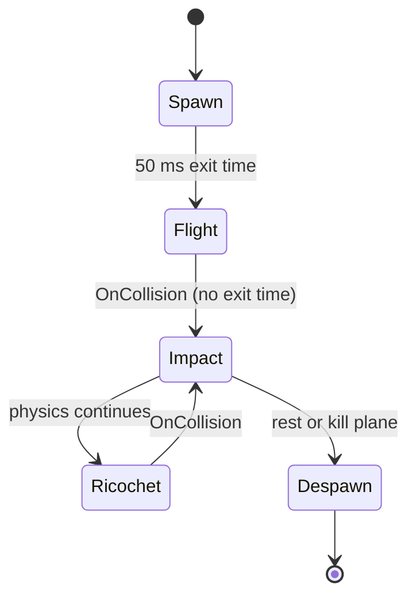

# 02 · Projectile Flight & Impact per Material — v1
Sources: M1 contract v0.2 §3 (materials, chunk caps), arena_brief_v2 §Material readability (break FX colours), art bible §Materials, wrecker_brief_v2 (spawn point).

## Projectile
| Phase | Duration | Frames@60 | Motion / VFX | Easing |
|---|---|---|---|---|
| Launch squash | 50 ms | 3 | ball scale 1.3×0.8 (stretch along velocity) → 1 | ease-out quad |
| Flight | physics-driven | — | velocity-aligned stretch: scale_z = 1 + clamp(v/40,0,0.25); spin 540°/s; cyan trail (Core colour, Wrecker-only cyan rule) | — |
| Split hook | apex (vy sign change) or 70% of predicted flight time, whichever first | — | `ANIM_PROJ_SPLIT_POINT` (Splitstrike only) | — |
| Pre-impact | — | — | none (no final-blow/win-shot slow-mo, OQ-C1) | — |
Trail: 0.35 s lifetime, width 0.25→0, cyan #22D3EE→transparent. Cosmetic trail skins replace material only (Addendum §4 item 2).
Flight is never animation-driven; animation is visual (child mesh) only.

## Impact per material
Damage shown in ≤2 steps (darken + crack decal) — art bible §Materials.
| Material | Hit flash | Hit stop | Piece reaction | Break FX (colours per arena_brief_v2) | Chunks (cap, contract §3) | Event |
|---|---|---|---|---|---|---|
| Wood (HP 30) | warm white 2 f | 0 ms | squash 0.92 at hit point 80 ms, ease-out-back | splinters #F5C994 + dust #CFA779, 12 particles, 400 ms | snap, ≤6 | `IMPACT_WOOD`, `BREAK_WOOD` |
| Brick (HP 60) | 2 f | 33 ms (2 f) on break only | shake ±0.02 m 120 ms; crack decal step 1 then 2 | red chunks + dust #D9A37E, 16 particles, 600 ms | brittle, ≤4 heavy | `IMPACT_BRICK`, `BREAK_BRICK` |
| Steel face (HP 120) | white 2 f | 0 | ring vibration 6 Hz 200 ms, 0.01 m | sparks #FFD27A + bits #3A3F48, 10 particles, 300 ms | — | `IMPACT_STEEL` |
| Steel joint (2× dmg) | gold ring #E8B04B flash 4 f | 50 ms (3 f) on joint break | joint pop: scale 1→1.15→0 150 ms then segment above released | big spark burst 24 particles + gold ring shockwave decal | joint failure preferred over mesh shatter | `IMPACT_STEEL_JOINT`, `BREAK_STEEL_JOINT` |
| Cliff (indestructible) | none | 0 | none | dust puff #C98A4B 6 particles | 0 | `IMPACT_TERRAIN` |
| Glass (light, new — material int 6) | white 1 f | 0–16 ms (≤1 f) on break only | shatter: piece breaks in one step (no crack step), squash none | shard sparkle burst, 10 particles, 300 ms (colours per Art) | **no chunk rigidbodies** (particles only) unless VFX decides otherwise | `IMPACT_GLASS`, `BREAK_GLASS` |
| Explosive crate (design term, DP §2 Chain Reactor; art asset `tgt_barrel_explosive` is the Ch1 model) | — | 66 ms (4 f) | 100 ms swell 1→1.2 then burst | red/white fireball 400 ms, smoke 1.2 s | follows Chain Reactor/explosion rules | `EXPLODE_CRATE` |
Projectile on impact: 1-frame squash, then despawn (pool) or ricochet per physics.

Event naming: `EXPLODE_CRATE` (alias, deprecated: `EXPLODE_BARREL`, still accepted by Sound Manager for one build).

Additional events: `BREAK_STEEL` (non-joint steel piece HP 0: heavy metal tear, 24 sparks), `DAMAGE_STEP` (payload material + step 1|2, raised when the darken + crack decal step applies), `DEBRIS_BURST` (payload material + chunk count, raised by DebrisPool when chunks spawn; throttle 1 per piece).

## Animator (projectile is code-driven; VFX state only)

Parameters: `Impact` trigger, `Material` int (0 wood,1 brick,2 steel,3 joint,4 terrain,5 explosive,6 glass) — values 0–5 unchanged, glass appended. Note: physics `MaterialType` (#18) numbers glass as 3; this Animator int is a separate list. Camera shake for glass = light, same as wood (07).

## Perf
Mid: ≤ 150 live particles from impacts, pooled VFX (no Instantiate), hit stop implemented as `Time.timeScale` dip ≤ 66 ms (see 07 caps). Low: particle counts ×0.5, dust → 1 flipbook quad, crack decals step 2 only on objective pieces, trail → 8-segment line, hit stop kept (it's cheap and readable).

## Reduce Motion
When the Reduce Motion setting is ON, apply the reductions for this file listed in `07_camera_shake_slowmo.md` § Reduce Motion (per-file interaction, "02").
