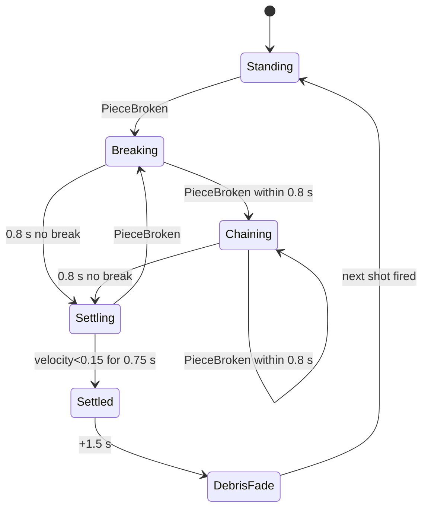

# 03 · Collapse Choreography & Debris Timing — v1
Sources: M1 contract v0.2 §3 (chunk caps wood 6 / brick 4 per piece, pooled), §4 settle (velocity <0.15 for 0.75 s), §7 (joint drops segment above; "keep total simulated rigidbodies modest"), Addendum §2 combo 0.8 s, SG-29 (combos never extend settle), arena_brief_v2 (kill plane at island edge).
**Animation never decides what breaks** — physics does. This spec controls feel only (staggering of VFX, debris lifetime, hit stop).

## Collapse beats (Clockwork Tower reference, contract §7)
| Beat | Trigger | Timing | Feel |
|---|---|---|---|
| 1 Break | piece HP 0 | f0 | Break FX (02), hit stop per material |
| 2 Creak tell | support loss on segment above | 0–150 ms after break | segment above tilts ≤2° via physics; `COLLAPSE_CREAK` sfx; 1 dust puff at seam |
| 3 Drop | segment loses all supports | physics | dust ring at base on ground contact `COLLAPSE_LAND` (param `material`: wood / brick / steel = dominant material of the landing segment by mass) |
| 4 Chain | each further ObjectivePiece break within 0.8 s | per break | combo UI (06), VFX stagger: max 3 break FX spawns per 100 ms; extra queued ≤ 200 ms or dropped (sound still plays, ≤4 voices) |
| 5 Settle | contract §4 | ≥ 750 ms quiet | debris fade starts |
| 6 Off-island | piece crosses kill plane | — | `DEBRIS_FALL_OFF` sfx (whoosh), despawn at kill plane +2 s |

## Debris lifecycle
| Stage | Duration | Frames@60 | Rule |
|---|---|---|---|
| Spawn | 0 | — | chunks per piece: wood ≤6, brick ≤4 (contract); steel: joint pop, no chunks |
| Active physics | until velocity <0.15 or 2.5 s | ≤150 | after 2.5 s chunks → kinematic sleep |
| Rest | 1.5 s | 90 | static |
| Fade | 500 ms | 30 | scale 1→0 ease-in quad (no alpha → avoids transparent overdraw) |
| Pool return | — | — | |
Non-objective chunks never count toward destroyed %; objective mass accounting is on the source piece (contract §1), so fading chunks is safe.
Global cap (approved, Gameplay_Feel_Answers_v1 OQ-D1): **high 90 / mid 60 / low 25 simulated debris rigidbodies**. At the cap, the oldest settled chunks are converted to visual-only debris (collider + RB removed) or despawned first; new chunks then spawn as simulated. Low-tier chunk halving is approved (OQ-D2): wood 3, brick 2, visual only — destroyed mass is always counted on the source piece, so tier never changes % or stars.

## Animator (per-structure "CollapseDirector", script state machine)

Settle never waits for debris fade (SG-29 spirit: VFX never extends gameplay settle).

## Perf
High: ≤90 debris RBs. Mid: ≤60 debris RBs, ≤ 1.5 ms physics; FX spawns rate-limited 30/s. Low: 25 RBs, chunk counts halved (wood 3, brick 2), dust ring flipbook, creak dust off, Physics fixedDeltaTime unchanged (determinism for retry).

## Reduce Motion
When the Reduce Motion setting is ON, apply the reductions for this file listed in `07_camera_shake_slowmo.md` § Reduce Motion (per-file interaction, "03").
