# 04 · Power-up Motion & VFX Timing — v1
Sources: Design Pack v1 §2 (effects, radii, durations), SG-08 (inclusive radii, splash values), wrecker_brief_v2 slots, ui_system (slot colours). Effect values/radii come from the gameplay data asset; VFX **read** those values (never hard-coded) so visuals always match rules.
Common arm sequence (tap again = disarm, `PU_DISARM`, except Time Fracture) (on Wrecker): tap HUD power-up → `SlotSwap`/`PowerArmed` (01) → slot part pulses in slot colour; `PU_ARM_<NAME>` event. Use costs no shot (DP §2).

| Power-up (slot) | Gameplay (DP §2) | Motion / VFX timeline (ms / f@60) | Easing | Events |
|---|---|---|---|---|
| Shockwave Core (Core, cyan) | impact: 40 dmg to pieces 1 link deep | 0: cyan flash 3 f · 0–400/24 f: ring scales 0→connected-bounds, alpha 1→0 · each linked piece gets a 1-f flash staggered 16 ms by link order (max 12) | ring ease-out cubic | `PU_SHOCKWAVE_IMPACT`, `PU_SHOCKWAVE_RING` |
| Splitstrike (Module, violet) | splits into 3 at apex **or 70% of predicted flight time, whichever first** (OQ-P2); hit before split point = no split, full single-shot damage, charge spent | split point: 66/4 f violet pop, projectile scale 1→1.3→split; 3 children fan out, trails violet; each child impact uses 02 at 0.8 scale | pop ease-out-back | `PU_SPLIT` (at split point), impacts per child; no-split hit uses normal 02 impact |
| Gravity Well (Module, violet) | pulls debris ≤4 m for 1.5 s, then burst 60 dmg | 0–150/9 f: vortex opens 0→4 m radius disc · 150–1500/90 f: spiral swirl loop, debris pulled (physics) · 1500/90 f: 100 ms implode then burst ring 300 ms | open ease-out back, implode ease-in expo | `PU_GRAVITY_OPEN`, `PU_GRAVITY_LOOP`(start/stop), `PU_GRAVITY_BURST` |
| Chain Reactor (Core, cyan) | detonates explosive crates/cores ≤3 m | impact: 3 m sphere pulse 200 ms · cyan arc (lightning line) to each target, staggered 80 ms by distance · each target uses `EXPLODE_CRATE` (02) | arc linear, pulse ease-out | `PU_CHAIN_PULSE`, `PU_CHAIN_LINK` (per target) |
| Phase Piercer (Booster, orange) | passes through first 2 pieces, full dmg to 3rd | projectile ghosted (fresnel orange, 60% opacity) · pass-through: ripple decal 150 ms on piece 1 & 2, no hit stop · 3rd: solidify 1 f + normal impact | — | `PU_PHASE_PASS` ×2, `PU_PHASE_HIT` |
| Time Fracture (Booster, orange) | moving parts at 25% for 4 s **real time, starting when armed** (OQ-P3); charge spent on arm, cannot be un-armed; if a shot is fired during the slow, it lasts until that shot's impact | arm 0–200/12 f: screen crack overlay in from the Booster ring, desaturate env 30% · 4000/240 f effect · last 500/30 f before the 4 s end: crack pulses 2 Hz warning (skipped if extended by an in-flight shot) · end (4 s or that shot's impact) 200 ms shatter-out | in ease-out, out ease-in | `PU_TIME_START`, `PU_TIME_WARN`, `PU_TIME_END` |

Time Fracture note: affects **moving parts only** (DP), so it's done by scaling those objects' animator/physics speed to 0.25, **not** global `Time.timeScale`. Wrecker aim/UI run unscaled.

## Animator (shared PowerUpFX controller, one instance pooled per active power-up)
Parameters: `Type` int, `Phase` trigger, `End` trigger.

```mermaid
stateDiagram-v2
    [*] --> Armed
    Armed --> InFlight: Fire
    Armed --> [*]: Disarm (any time before FIRE, free, charge not spent; not Time Fracture)
    Armed --> Active: Type==TimeFracture (starts on arm, charge spent)
    InFlight --> Trigger: SplitPoint (Splitstrike) / Impact (others)
    Trigger --> Active: exit time 1.0
    Active --> Release: duration elapsed (Gravity 1.5 s, Time 4 s) or instant
    Release --> [*]: exit time 1.0
```

Interrupt: Active cannot be interrupted except by Retry (hard reset). Disarm before FIRE is free (OQ-P1); charge is spent only on FIRE, except Time Fracture (spent on arm). Time Fracture Active: Release at 4 s real time, or at impact of a shot fired during it.

## Perf
Mid: per effect ≤ 80 particles, 1 full-screen pass max (Time Fracture overlay). Low: Shockwave ring = single mesh, link flashes off; Gravity spiral 1 flipbook quad, no debris trails; Chain arcs = line renderer 4 segments; Phase ghost = flat orange tint (no fresnel); Time Fracture = static crack sprite + no desaturation pass (use color tint on UI overlay).

## Reduce Motion
When the Reduce Motion setting is ON, apply the reductions for this file listed in `07_camera_shake_slowmo.md` § Reduce Motion (per-file interaction, "04").
