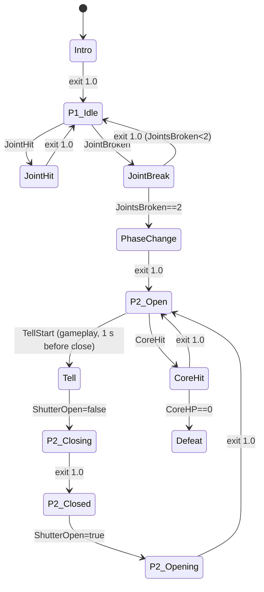
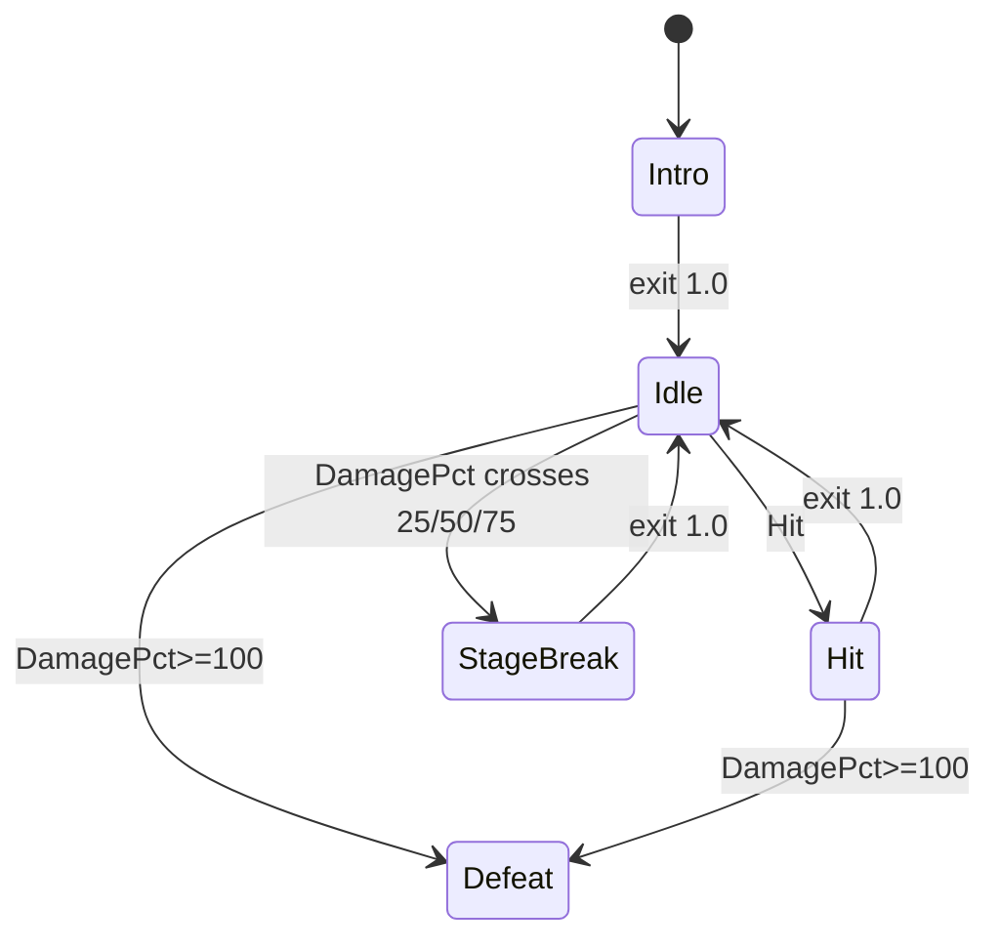

# 05 · Bosses: Tidewarden (L10) & Emberforge Titan — v1
Sources: Design Pack v1 §1 L10, SG-05 (turn-based shutter), asset_list (boss parts), art bible §Lighting (boss red/orange key), ui_system (shutter tell for 1 s; rate changed to 2.4 Hz to lock to 144 BPM music, Sound Manager 16 Oct). "Rules readable from animation only; no hidden HP math" (DP).

## Tidewarden
Parts: plank armor, 2 steel shoulder joints (gold weak ring), brick shutter (emissive orange tell), lantern core.
| State | Duration | Frames@60 | Motion | Easing | Event |
|---|---|---|---|---|---|
| Intro | 2500 | 150 | rises 2 m from sea-stack mount, lantern flicker on, arms spread at 1000–1800 ms | ease-out-back | `BOSS_TIDE_INTRO` (0), `BOSS_TIDE_ARMS_RISE` (+60 f / 1000 ms) |
| P1 Idle (loop) | 3000 | 180 | sway ±1.5°, lantern pulse, plank creak | sine | — |
| Plank hit | 200 | 12 | plank kick 4°, return ease-out-back | — | `IMPACT_WOOD` |
| Shoulder joint hit | 300 | 18 | arm flinch 8°, gold ring flash | ease-out | `BOSS_TIDE_JOINT_HIT` |
| Joint break (each) | 600 | 36 | arm sags 20°, sparks | ease-in | `BOSS_TIDE_JOINT_BREAK` |
| **Phase change** (both joints broken) | 1800 | 108 | 0–600: arms detach as **physics debris** and fall off the sea-stack (non-objective: no score/combo, OQ-B2; count toward the debris cap in 03) · 600: arms land (`ARMS_LAND`) · **700–1250: chest plates swing open 110°** (550 ms) · **1250–1800: lantern core reveal, light flare** (550 ms) — total still 1800 ms | arms ease-in quad, plates ease-out-back | `BOSS_TIDE_ARMS_DROP` (0), `BOSS_TIDE_ARMS_LAND` (+36 f / 600 ms), `BOSS_TIDE_CHEST_OPEN` (+42 f / 700 ms), `BOSS_TIDE_PHASE2` (+75 f / 1250 ms) |
| P2 Shutter Open (idle) | loop | — | core glows, shutter retracted | — | — |
| Shutter tell | last 1000 ms of settle before close | 60 | shutter edge pulses orange at **exactly 2.4 Hz, beat-locked to the 144 BPM Tidewarden music** (one pulse every 25 f; 2.4 pulses over 1 s; intensity 0.6+0.4·(0.5+0.5·sin(4.8π·(t−tellStart)))) | sine | `BOSS_TIDE_TELL` |
| Shutter close | **300** | 18 | tween from open to closed pose (code: slide 1.7 m down), no teleport | ease-in cubic (accelerating slam), thunk at 18 f | `BOSS_TIDE_SHUTTER_CLOSE` fires at tween START (frame 0); audio file carries the thunk at +300 ms |
| Shutter open | 350 | 21 | rotate open | ease-out-back | `BOSS_TIDE_SHUTTER_OPEN` |
| Core hit (open) | 500 | 30 | core flash white; health shown **only** by crack steps on the model: intact → cracked (hit 1) → destroyed (hit 2); no HUD pips (OQ-B1) | — | `BOSS_TIDE_CORE_HIT` |
| Shot on closed shutter | 200 | 12 | brick chip, no core reaction (SG-05) | — | `IMPACT_BRICK` |
| Defeat cinematic | **4000 (confirmed 4.0 s)** | 240 | core implode 500, body crumbles top-down, collapse into sea-stack (final collapse lands at 3500 ms / 210 f) | ease-in | `BOSS_TIDE_DEFEAT` (0), `BOSS_TIDE_DEFEAT_COLLAPSE` (+210 f / 3500 ms) |
Shutter toggles after every shot starting open (SG-05); Animator just mirrors `ShutterOpen` bool from gameplay.

Params: `JointHit`/`JointBroken`/`CoreHit`/`TellStart` triggers, `JointsBroken` int, `ShutterOpen` bool, `CoreHP` int. PhaseChange and Defeat are non-interruptible.

## Emberforge Titan (Daily)
Charcoal iron, orange cracks #FF7A1A, molten core #FFD23F, heated joints (asset_list); red/orange key light (art bible). Rules vary daily from server config (DP §3), so animation is generic + rule-tinted.
| State | Duration | Frames | Motion | Event |
|---|---|---|---|---|
| Ranked start (ranked only) | 1200 | 72 | triggered by the RANKED button (v1 Daily Titan screen, separate from PRACTICE): "RANKED" banner + Titan eyes ignite, before Intro | ease-out-back | `BOSS_TITAN_RANKED_START` |
| Intro | 3000 | 180 | rises from lava, cracks ignite bottom-up 1.5 s, roar pose | `BOSS_TITAN_INTRO` |
| Idle loop | 4000 | 240 | heavy breathing scale 1.0↔1.01, crack emissive 1↔1.4, ember particles | — |
| Hit (by material) | 250 | 15 | 02 impacts + crack emissive flash; heated joint: extra sparks; damage counter (0–10,000, v1; no HP bar) ticks up 400 ms ease-out | `BOSS_TITAN_HIT`, `UI_DAMAGE_TICK` |
| Damage stage at 25 / 50 / 75% of the 10,000 max (defeat at 100%, OQ-B3) | 800 | 48 | piece sheds, stagger 5°, cracks widen | `BOSS_TITAN_STAGE` |
| Kill | 4500 | 270 | core overload flash, cracks white-hot, collapse forward, lava splash | `BOSS_TITAN_DEFEAT` |
| Rule visual (day's special rule, e.g. heated joints glow) | loop | — | per-rule emissive/particles on affected parts; starts after Intro | `BOSS_TITAN_RULE` |
| Shots out (no kill) | — | — | stays in Idle; no taunt or attack | — |
The Titan **never attacks** (OQ-B3): only idle, flinch (Hit), stage-break, defeat and rule visuals.

Params: `Hit` trigger, `DamagePct` float, `Stage` int (1–3). StageBreak and Defeat non-interruptible. Rule visuals run on a separate additive layer.

## Perf
Boss rigs: ≤ 40 bones, GPU skinning, 1 Animator, culling AlwaysAnimate. Mid: ember particles 40; Low: embers 10, crack emissive via vertex colour pulse, defeat cinematic swaps physics crumble for authored clip (baked), no bloom pulse.

## Reduce Motion
When the Reduce Motion setting is ON, apply the reductions for this file listed in `07_camera_shake_slowmo.md` § Reduce Motion (per-file interaction, "05").
