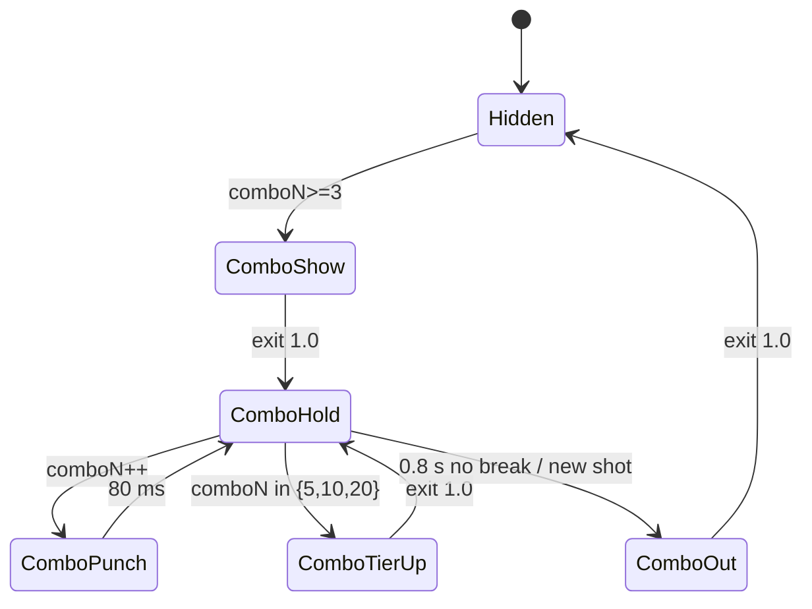

# 06 · UI Motion — v1
Sources: art bible §Motion/juice (button 0.92/1.05 120 ms, stars 0→1.3→1 250 ms, COMBO from x3 bigger at x5/10/20, coin fly, panels ease-out-back 300 ms, shake 0.15 s), Addendum §2 (combo 0.8 s, from x3), ui_system (nodes, gate, stars sizes), asset_list (`ui_label_combo` x3/x5/x10/x20).
All UI motion uses unscaled time (unaffected by slow-mo/hit stop). Implement with tweens (DOTween-style) not Animators, except the win screen sequence (Timeline/Animator OK).

| Element | Timing (ms / f@60) | Motion | Easing | Event |
|---|---|---|---|---|
| Button press/release | 120 / 7 | scale 1→0.92 press, release →1.05→1 | out quad / out-back | `UI_BTN_PRESS` (payload `type`: confirm / back / error) |
| Panel in | 300 / 18 | slide up from +200 px, alpha 0→1 | ease-out-back 1.2 | `UI_PANEL_IN` |
| Panel out | 200 / 12 | slide down, alpha →0 | ease-in quad | `UI_PANEL_OUT` |
| Star pop (each) | 250 / 15, stagger 300 / 18 | scale 0→1.3 (150) →1 (100), sparkle burst at peak | out-back / in-out | `UI_STAR_1/2/3` |
| Empty star | 150 / 9 | fade in navy, no pop | linear | — |
| Mastery tick | 300 / 18 after last star | check draws 200 ms + gold ping | ease-out | `UI_MASTERY_TICK` |
| COMBO xN (N≥3 only, violet `ui_label_combo`) | in 180 / 11, hold until combo ends, out 250 / 15 | scale 0→peak→1: x3–4 peak 1.2 size S, x5–9 1.35 M, x10–19 1.5 L + rays, x20+ 1.7 XL + screen-edge flash. Each increment: punch 1.0→1.12 80 ms | out-back | `UI_COMBO_UP` (N) , `UI_COMBO_TIER` (5/10/20) |
| Score count-up | 600 / 36 | numeric tween | ease-out quad | `UI_SCORE_TICK` (every 50 ms, max 12) |
| Coin fly-to-bar | 700 / 42, 8 coins stagger 40 ms | bezier arc to pill, pill punch 1.1 | in-out cubic | `UI_COIN_LAND` (per coin, throttled) |
| Reward reveal (chest) | 1200 / 72 | shake 400, lid pop 200 ease-out-back, items fan 600 | — | `UI_CHEST_SHAKE`, `UI_CHEST_OPEN` |
| Reward day claim | 400 / 24 | tile scale 1→1.1→1, ✔ stamp | out-back | `UI_CLAIM` |
| Map node unlock | 1100 / 66 | lock shakes 200 → lock pops off 150 (out-back, falls) → node grey→cyan colour 300 → ring + Wrecker marker hops 450 to node | — | `UI_NODE_UNLOCK`, `UI_MARKER_HOP` |
| Bridge gate open | 900 / 54 | padlock pop, plank sign swings 90° | ease-out-back | `UI_GATE_OPEN` |
| Shots-left decrement | 200 / 12 | number punch 1.25 cyan flash | out-back | `UI_SHOT_SPEND` |
| % bar fill | 400 / 24 per settle | width tween; on reaching the win threshold ≥85% (contract v0.2 §4, PM decision; never 80/90%) tick flashes white | ease-out | `UI_THRESHOLD_HIT` |
| Win sequence | ribbon 300 → stars (3×300) → mastery → score 600 → coins 700 | confetti + rays (rays rotate 20°/s) | — | `UI_WIN` |
| Fail screen | panel 300 / 18, 0★ empty stars fade, Retry button pop | ease-out-back | `UI_FAIL` |
| Free Hint button appear (fail screen, 2nd fail in a row+) | 300 / 18 after Retry | scale 0→1.1→1, cyan | out-back | `UI_HINT_BUTTON_APPEAR` |
| Season tier-up | 900 / 54 | tier tile fills, ✔ stamp, track scrolls to next | out-back | `UI_SEASON_TIER_UP` |
| Shard reward | 600 / 36 | shard icon (pink) flies to pill | in-out cubic | `UI_SHARD_GAIN` |
| Extra charge reward (daily) | 700 / 42 | bolt icon flies to loadout slot, slot badge +1 punch | in-out cubic | `UI_EXTRA_CHARGE` |
| Tab switch / toggle | 150 / 9 | tab gold fill slide; toggle knob slide (no overshoot) | out-quad | `UI_TAB`, `UI_TOGGLE` |
| Damage counter (Titan) | 400 / 24 per hit | number tween + punch 1.1 | out-quad | `UI_DAMAGE_TICK` (throttle 50 ms) |
| Free Hint pulse | 1000 loop | target ring pulse 1→1.2, arc dash scroll | sine | `UI_HINT_SHOW` |

Win screen: Ribbon → Star1 → Star2 → Star3 → Mastery → Score → Coins → Buttons; tap anywhere = skip to end state (all values final).

## Perf
UI canvases split (static vs animated). Mid: confetti 120 particles UI-space. Low: confetti 40, rays static, sparkle 4 per star, coin fly 4 coins. Never more than 1 full-screen additive overlay.

## Reduce Motion
When the Reduce Motion setting is ON, apply the reductions for this file listed in `07_camera_shake_slowmo.md` § Reduce Motion (per-file interaction, "06").

## Screen motion aligned to v1 layout (ART-1..10 resolved, 2026-10-16)
Rule: v1 (`art/v1/`) is canonical for layout, data and states; v2 is only the visual/style target; v1 + design docs win where they differ.

### Gameplay HUD (v1 mockup 04)
| Element | Motion |
|---|---|
| SCORE (live partial, no shot bonus until win) | per settle: 300 ms count-up ease-out, punch 1.08 (`UI_SCORE_TICK`) |
| Shots left (cyan number, art bible §Numbers) | on FIRE: number punch 1.25 + cyan flash 200 ms (`UI_SHOT_SPEND`) |
| % destroyed bar + **85% win tick** | tick x-position = level data `winThreshold` (default 0.85; v1: white tick, never star markers). Tick appears with HUD (fade 200 ms). Fill tween 400 ms ease-out per settle. While fill < threshold: tick static white. On fill reaching tick: tick scales 1→1.4→1 (250 ms out-back) + white glint sweep across bar 300 ms, then tick stays gold-white, no loop (`UI_THRESHOLD_HIT`). Reduce Motion: no scale, colour change only |
| Power-up buttons (Core / Module / Booster, slot colours) + charge badge | badge default **x1** (Chain Reactor **x2**) from loadout data. Tap = arm: button scale 1.1, slot-colour ring pulse 1 Hz while armed. On FIRE with armed power-up: badge punch 1.2 + count decrement 200 ms (`UI_CHARGE_SPEND`); at 0 the button greys over 200 ms |
| **FIRE (orange, v1)** | press per button spec; disabled (grey) from FIRE tap until `ANIM_WRECKER_READY`; Ready: scale 0.95→1.05→1 + orange glow ring 300 ms (01) |
| COMBO xN | **violet** `ui_label_combo` (asset list); pop sizes per table above |
| Pause | button press only |
| FREE HINT | **not in the gameplay HUD.** Only the hint pulse/ghost arc in-world on the next attempt's first aim (Addendum §1) |

### Fail screen
Panel in 300 → 0★ empty stars fade → RETRY / MAP pop. **FREE HINT button** only from the 2nd fail in a row on that level (and never in Titan ranked): appears 300 ms after RETRY, scale 0→1.1→1, cyan button, **no video/ad icon** (`UI_HINT_BUTTON_APPEAR`).

### Level Complete (v1 mockup 06 order)
Ribbon drop 300 → stars (300 stagger; unearned = empty navy, no sparkle) → **mastery tick row** → score panel → count-up 600 → shots-left row 200 → coins count + fly 700 → NEXT then MAP (+100 ms).
Mastery row: row slides in 200 ms ease-out with goal text; if achieved: checkbox ✔ draws 200 ms + gold ping scale 1→1.2→1 (150 ms out-back) (`UI_MASTERY_TICK`); if not achieved: empty box, row at 60% opacity, no sound.

### World map (v1 mockup 02)
Node states: **locked** (grey + lock), **current** (cyan + ring + Wrecker marker), **completed** (gold + 0–3 stars, mixed per level best), boss (red, gold ring), bridge gate (locked/open, no star count). Nodes follow the single path in level order.
- Current node: cyan ring pulse 1.2 s loop (scale 1→1.08).
- Completed node new stars: stars pop in on map return (250 ms, 100 ms stagger).
- Unlock (after clearing current): lock shakes 200 → lock pops off 150 → node grey→cyan 300 → **marker travels** along the path spline from old node to new: 120 ms/node-segment min 450 ms, ease-in-out cubic, 3 small hops (`UI_MARKER_HOP` on each landing) → ring starts pulsing. Old node turns gold with its stars.
- Bridge gate: when previous island's last node is cleared, padlock pops (200), sign swings open 90° (700 ease-out-back) (`UI_GATE_OPEN`) **before** the marker crosses; the marker waits at the gate.
- Nav tabs `UI_TAB` (selected raises 12 px, 150 ms out-quad).

### Daily Titan screen (v1 mockup 08)
Today's rule card, reset timer (05:30 IST), **separate RANKED and PRACTICE buttons** (ranked disabled with "Used" state after the attempt). No HP bar. In the fight HUD the score is a **damage counter 0–10,000**: per hit, count-up 400 ms ease-out-quad, punch 1.1 (`UI_DAMAGE_TICK`, throttle 50 ms); on kill, shot bonus (+500 × shots left) counts up after the damage, 600 ms. RANKED press → `BOSS_TITAN_RANKED_START` sequence (05).

### Daily rewards (Design Pack §3 / v1 mockup 11)
Days: 1 100 coins · 2 extra charge · 3 150 coins · 4 cosmetic shard · 5 200 coins · 6 extra charge · 7 chest (coins + 3 shards). Placeholder state: **Days 1–3 claimed (✔ overlay), Day 4 = today (gold glow pulse 1.5 s loop), Days 5–7 future.** Day 7 is the larger chest tile but **not** highlighted unless it is today. Claim: today tile 1→1.1→1 + ✔ stamp (`UI_CLAIM`), then reward fly (coin / shard `UI_SHARD_GAIN` / extra charge `UI_EXTRA_CHARGE`); glow moves to the next day only on the next server day.

### Level briefing (v1 mockup 03)
Slot drop/swap: icon scale 0→1.15→1 300 ms with slot-colour flash; locked slot silhouette shakes 150 ms on tap.
