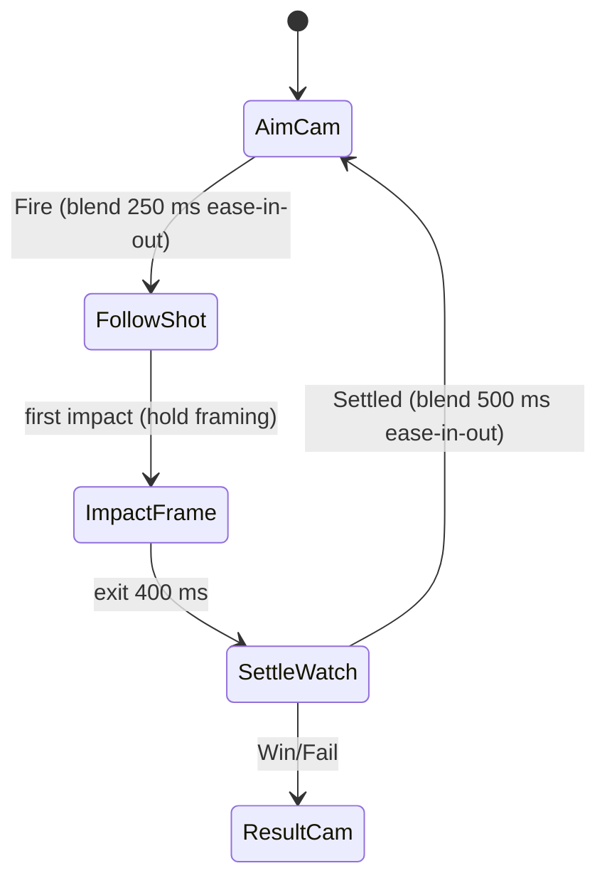

# 07 · Camera Shake & Slow-mo Rules — v1
Sources: art bible §Motion (screen shake on impact 0.15 s), wrecker_brief_v2 / arena_brief_v2 (camera low behind, ~15° pitch, FOV 50), contract §7 (full tower readable without constant orbit), SG-29 (nothing extends settle).
Implementation: Cinemachine Impulse (or equivalent), perlin noise, all values data-driven in `CameraFeelConfig` SO.

## Shake table
| Trigger | Amplitude pos / rot | Freq | Duration (ms / f) | Decay |
|---|---|---|---|---|
| Fire | 0.06 m / 0.6° | 9 Hz | 180 / 11 | ease-out quad |
| Impact wood / glass | 0.02 / 0.2° | 14 | 100 / 6 | out |
| Impact brick break | 0.04 / 0.4° | 12 | 150 / 9 | out |
| Steel joint break | 0.06 / 0.6° | 12 | 150 / 9 | out |
| Segment collapse land | 0.08 / 0.8° | 8 | 250 / 15 | out cubic |
| Explosion / Chain Reactor | 0.10 / 1.0° | 10 | 300 / 18 | out cubic |
| Gravity Well burst | 0.08 / 0.8° | 10 | 250 / 15 | out |
| Boss phase change / defeat | 0.12 / 1.2° | 6 | 600 / 36 | out cubic |
Caps: summed amplitude ≤ 0.15 m / 1.5°; new shakes add, oldest decays. Reduce Shake or Reduce Motion ON → shake ×0 (see Accessibility section).

## Slow-mo / hit stop
| Rule | Value |
|---|---|
| Hit stop (02 table) | ≤ 66 ms, `Time.timeScale` = 0.05 |
| Big-collapse slow-mo | when ≥ 30% objective mass falls within 0.5 s: timeScale 0.4 for 600 ms real time, ease in 100 / out 200 ms |
| Win-shot / final-blow slow-mo | **none** (OQ-C1): a win (≥85%, contract v0.2 §4) is only known after settle; the win camera plays after settle |
| Boss phase-break slow-mo | Tidewarden phase change, Titan stage break: timeScale 0.5 for 500 ms real, ease in 100 / out 200 ms (OQ-C3 allows) |
| Max slow-mo per shot | 1 event, total ≤ 800 ms real |
| Where allowed | campaign, weekly events, Daily Titan **practice** (OQ-C3) |
| Never during | Daily Titan **ranked** only (mode rule); also skipped while Time Fracture is active (it already slows) and during aim |
| Physics | slow-mo scales `Time.timeScale`; `fixedDeltaTime` scales proportionally for smoothness; settle timer uses **scaled** time so rules (0.75 s) are unchanged in sim time |
| UI / aim | unscaled |

## Camera states

FollowShot: soft follow only (≤ 20% toward projectile) so the structure stays readable (contract §7).

## Perf
Shake is cheap. Low tier: shake ×0.7, slow-mo kept but no motion blur/chromatic; no post FX added by shake.

## Accessibility: Reduce Shake + Reduce Motion (PM 2026-10-16, Game designer OQ-C2)
Two settings, **both default OFF**, except that Reduce Motion turns ON automatically when Android "Remove animations" is on (see below).
| Setting | Exactly what it does |
|---|---|
| **Reduce Shake** | Turns off camera shake only (all triggers in the shake table ×0). Nothing else changes. |
| **Reduce Motion** | The full Reduce Motion spec below **and forces shake off** — Reduce Motion implies Reduce Shake. |
Interaction: effective shake = 0 if `ReduceShake || ReduceMotion`. While Reduce Motion is ON, the Reduce Shake row shows ON, greyed and locked ("Included in Reduce Motion"); turning Reduce Motion OFF restores Reduce Shake's own stored value. Neither setting changes gameplay, input timing, or audio.
**Auto-enable (PM):** on launch, if Android `Settings.Global.ANIMATOR_DURATION_SCALE == 0` ("Remove animations") and the player has never set Reduce Motion manually, Reduce Motion is set ON. The player can still turn it OFF in Settings; that manual choice is saved and wins on later launches.
**No winning-shot slow-mo** exists in any mode or setting.

### Reduce Motion
Setting `ReduceMotion` (bool, **default OFF**), stored in local player prefs + profile, applies instantly (no restart). Read by `MotionSettings` service; every system below queries it — no per-system toggles.

### Exact reductions when ON
| Area | Reduction |
|---|---|
| Camera shake (all triggers, 07 table) | amplitude ×0 (disabled). Fire keeps a 2 px HUD-free "kick" on the barrel model only (no camera move) |
| Slow-mo (big-collapse) | disabled (timeScale stays 1) |
| Hit stop (02) | capped at 33 ms (2 f) and timeScale 0.3 (not 0.05) |
| Flashes (muzzle, hit flash, joint ring, core hit, combo edge flash) | peak emissive/additive intensity ×0.4, alpha ≤ 0.5, duration ≥ 100 ms ramps (no 1–2 f strobe) |
| Full-screen flashes / overlays | none: x20 combo edge flash off, Time Fracture overlay = static 25% tint fading 300 ms, boss defeat flare off, win rays static |
| Repeating pulses (shutter tell 2.4 Hz, hint pulse, PowerArmed) | **gameplay tells kept** (shutter tell is a rule signal, DP L10) but as colour change, amplitude ×0.5, no brightness strobe > 3 Hz |
| Camera blends (FollowShot) | FollowShot off: camera stays in AimCam framing; blends ≥ 400 ms ease-in-out |
| UI motion (06) | overshoots removed (out-back → out-quad), scale pops capped 1.1, confetti ×0.25, coin fly kept (4 coins) |
| Idle fidget / breathing loops | fidget off, idle amplitudes ×0.5 |
Gameplay, timings that affect input, and audio are unchanged (audio events still fire; `CAM_SLOWMO_*` not raised).

### Per-file interaction
- 01 Cannon: no fire shake; muzzle flash ×0.4; recoil motion kept (readability); fidget off.
- 02 Impacts: hit flash capped; hit stop ≤33 ms; particle counts unchanged.
- 03 Collapse: no collapse-land shake; dust unchanged.
- 04 Power-ups: Shockwave ring/Chain arcs alpha ≤0.5; Shockwave rapid link flashes collapse into ONE 100 ms tint (alpha ≤0.5, ease-out) per activation; Time Fracture no full-screen crack animation, keeps its static 30% env desaturation (a non-flashing state cue) under the static 25% tint; Gravity burst no shake.
- 05 Bosses: phase change/defeat no shake or flare; shutter tell kept as colour change.
- 06 UI: see table; star pops 0→1.1→1.
- 07: shake 0, slow-mo off, FollowShot off.

### Settings UI toggles
Two rows, in order "Reduce Screen Shake", "Reduce Motion"; each row (v1 style: navy panel, label 36 px+, ON/OFF pill switch, row hit box ≥144 px). Toggle motion: knob slides 150 ms ease-out-quad, track colour cross-fade 150 ms (navy → cyan ON), no overshoot/bounce **in either mode**;  Preview: none (no shake demo). Toggle sfx `UI_TOGGLE`. Default OFF; Reduce Motion auto-ON with Android "Remove animations" (above).
